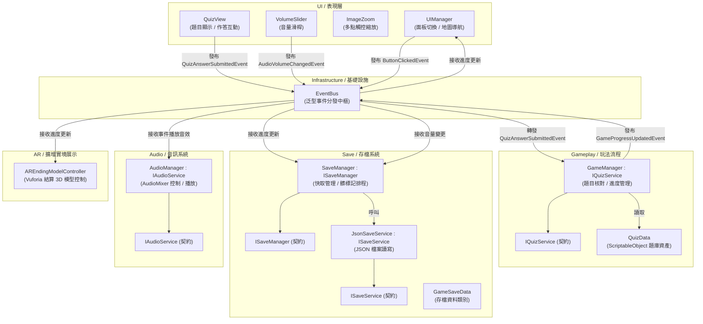

# 《社影流光》 (Temporal Shrine)

<div align="center">

[](https://unity.com/)
[-blue?style=for-the-badge)](https://unity.com/)
[](https://developer.vuforia.com/)
[](https://unity.com/)
[](https://learn.microsoft.com/dotnet/csharp/)

</div>

## 專案簡介

《社影流光 (Temporal Shrine)》是一款基於行動擴增實境 (Mobile AR) 的新竹神社歷史文化導覽遊戲。使用者透過手機鏡頭掃描實體景點或圖卡，觸發對應之神社建築 3D 模型與歷史解說，並藉由問答測驗加深文化認知，達成古蹟虛實整合體驗。

本專案重點在於 **Vuforia 圖卡辨識追蹤**、**行動端雙指觸控手勢照片縮放**、**ScriptableObject 資料驅動題庫**、**UI Animator 參數雜湊快取** 與 **本地 JSON 存檔管線**。

---

## 實機展示影片

* 🎥 **實機展示影片**：[https://www.youtube.com/watch?v=VR360ch3UmI](https://www.youtube.com/watch?v=VR360ch3UmI)

---

## 核心玩法與特色

基於行動端擴增實境 (Mobile AR) 的新竹神社歷史文化導覽，實現古蹟虛實疊加與互動解謎：

* **神社景點導覽地圖**：
  - 主選單提供手繪風新竹神社導覽地圖，標記 5 大核心歷史景點（如拜殿、鳥居、手水舍等）。
  - 玩家可自由切換不同景點站點進行探索學習。
* **Vuforia 圖卡掃描與 3D 建築錨定**：
  - 使用者將手機相機對準現場實體解說牌或圖卡進行辨識。
  - 辨識成功後，畫面中即時生動浮現縮小比例的神社建築 3D 模型與古蹟結構細節，達成虛實疊加視覺。
* **老照片雙指縮放互動 (Pinch-to-Zoom)**：
  - 每個景點收錄珍貴歷史老照片與文獻資料。
  - 使用者可直接在手機螢幕上以雙指平移、拉伸縮放（支援手勢平滑縮放與邊界鉗制），清晰檢視數十年前的神社原始風貌細節。
* **文化知識隨堂測驗**：
  - 每個景點配有專屬文化歷史選擇題（如「神社入口的鳥居象徵什麼意義？」）。
  - 答對時播放音效並推進探索進度條，完成全站點收集。
* **全通關 AR 結算模型展示**：
  - 通過全部 5 個景點測驗後，解鎖終極結算獎勵：在實體桌面上透過 AR 投影完整新竹神社 3D 模型，並支援 360 度環繞旋轉觀賞。

---

## 系統架構圖



---

## 軟體架構與技術實踐深度說明

### 1. Vuforia Image Target AR 空間追蹤與模型錨定
* **用了什麼技術**：Vuforia Engine 圖卡辨識追蹤、`DefaultObserverEventHandler` 與 `AREndingModelController`。
* **為何而用**：使用者在導覽時，透過手機鏡頭辨識實體景點解說牌或圖卡，將歷史神社 3D 模型精確疊加錨定在真實空間中，提供虛實整合的文化導覽體驗。
* **怎麼設計**：在場景 `ImageTarget` 配置辨識事件回呼，並由 `AREndingModelController` 監聽。當全站點通關後，透過 `EventBus` 通知解鎖終極 3D 神社模型並啟動自體旋轉動畫。
* **用什麼方法 (回呼解耦/模式)**：
  - **觀察者模式 (Observer Pattern)**：圖卡識別回呼（`OnTargetFound` / `OnTargetLost`）轉發至領域控制器，UI 與模型渲染不直接綁定 Vuforia 內部 API。

### 2. 行動端雙指觸控手勢照片縮放 (Touch Gesture Pinch-to-Zoom)
* **用了什麼技術**：`ImageZoom.cs`，實作 Unity uGUI 事件介面 (`IScrollHandler`, `IPointerEnterHandler`, `IDragHandler`) 與原生 `Input.touchCount`。
* **為何而用**：讓使用者能在手機螢幕上自由細看珍貴歷史老照片的微觀細節，同時提供平滑自然的拖曳平移手感。
* **怎麼設計**：
  - 檢測雙指觸控時，計算當前兩指間距與前一幀間距之差值，動態更新 RectTransform 的 `localScale`。
  - 單指拖曳時更新 `anchoredPosition`，並依據父容器尺寸使用 `Mathf.Clamp` 進行平移邊界鉗制，防止照片拖出可視範圍。
* **用什麼方法 (演算法/原則)**：
  - **雙指距離插值縮放**：線性計算指距增量以映射縮放比例。
  - **邊界限制保護**：計算視圖寬高極值並鉗制座標，防止手勢穿幫。

### 3. ScriptableObject 資料驅動題庫架構 (QuizData)
* **用了什麼技術**：`Gameplay/QuizData.cs` 繼承 Unity `ScriptableObject`，配合 `IQuizService` 介面契約。
* **為何而用**：神社 5 大景點之歷史文化問答題（題目文本、選項清單、正確索引、詳細歷史解析）屬於靜態企劃配置資料。若硬編碼在 C# 腳本中，修改題目或微調錯別字皆需重新編譯腳本；若存成純文字檔又缺乏型別檢查。使用 ScriptableObject 能直接在 Unity Inspector 中可視化編輯並自動序列化為二進位/YAML 資產。
* **怎麼設計**：
  - 定義 `QuizData` 並加上 `[CreateAssetMenu(fileName = "NewQuizData", menuName = "TemporalShrine/Quiz Data")]`。
  - 題目內含 `questionText`、`options`（字串陣列）、`correctAnswerIndex` 與 `explanation`。
  - `GameManager` 實作 `IQuizService`，持有 `QuizData` 參照並於執行期驗證玩家點擊選項，驗證成功後廣播 `GameProgressUpdatedEvent`。
* **用什麼方法**：資料驅動架構 (Data-Driven Architecture)、依賴反轉原則 (DIP)。

### 4. 策略模式本地 JSON 存檔與髒標記排程 (Strategy & Dirty Flag Pattern)
* **用了什麼技術**：`ISaveService` 抽象介面、`JsonSaveService` 驅動與 `SaveManager`。
* **為何而用**：安全保存各景點通關解鎖進度與玩家音量偏好，避免每次作答變動都進行同步磁碟 I/O。
* **怎麼設計**：`SaveManager` 於記憶體中維護 `GameSaveData` 快取，透過 `ISaveService` 進行本機 JSON 檔案序列化。
* **用什麼方法**：
  - **策略模式與依賴反轉 (Strategy / DIP)**：存檔模組依賴抽象介面，底層讀寫細節完全隔離。
  - **髒標記模式 (Dirty Flag Pattern)**：作答過關或音量變動時標記 `isDirty`，定時批次寫入磁碟，並在 App 切換至後台或退出時執行安全儲存。

### 5. UI Animator 與字串雜湊快取最佳化 (Animator & StringToHash Optimization)
* **用了什麼技術**：Unity `Animator` 動畫元件、`Animator.StringToHash("isEnabled")` 靜態整數常數快取。
* **為何而用**：在導覽地圖展開/收合、以及 5 大景點圖標按鈕依序彈出時，若在執行期頻繁傳遞字串參數（如 `animator.SetBool("isEnabled", true)`），Unity 內部每次呼叫都會重複執行字串 Hash 計算並在堆積中產生暫存字串開銷與 GC Alloc。
* **怎麼設計**：
  - 在 `UIManager.cs` 頂部宣告靜態唯讀整數 `private static readonly int IsEnabledParamHash = Animator.StringToHash("isEnabled");`。
  - 在 `Awake` 初始化階段快取 `mapAnimator` 與 `sceneryButtonAnimators` 陣列，避免執行期呼叫 `GetComponent<Animator>()`。
  - 當玩家點選展開地圖或景點按鈕時，直接傳入預先計算好的 `IsEnabledParamHash` 呼叫 `animator.SetBool(IsEnabledParamHash, isOpen)`。
* **用什麼方法**：參數雜湊快取 (Param Hash Caching)、零執行期字串開銷最佳化 (Zero-GC Optimization)。

---

## 核心介面契約規範 (Interfaces)

| 介面契約 (Interface) | 實作類別 (Implementation) | 職責說明 |
| :--- | :--- | :--- |
| `IQuizService` | `GameManager` | 維護歷史景點探索進度條、作答核對與過關推進 |
| `ISaveManager` | `SaveManager` | 存檔快取管理、定時髒標記排程與退出時安全落盤 |
| `ISaveService` | `JsonSaveService` | 抽象化磁碟序列化行為，負責 JSON 檔案存取 |
| `IAudioService` | `AudioManager` | 集中調度按鈕音效、答對音效與 AudioMixer 音量控制 |

---

## 模組架構與檔案拓撲 (Architecture Topology)

```text
temporal-shrine/
├── AR/                 # Vuforia 圖卡追蹤與通關結算 3D 模型旋轉展示 (AREndingModelController)
├── Gameplay/           # 景點探索流程與 ScriptableObject 問答題庫 (GameManager, QuizData)
├── Infrastructure/     # 泛型 EventBus 事件匯流排與 UI Gradient 漸層輔助
├── Save/               # 策略模式本地 JSON 存檔 (SaveManager, JsonSaveService, GameSaveData)
├── Audio/              # AudioMixer 控制與音量滑桿綁定 (AudioManager, VolumeSlider)
└── UI/                 # 行動端手勢縮放、導覽地圖面板與問答視圖 (UIManager, QuizView, ImageZoom)
```
